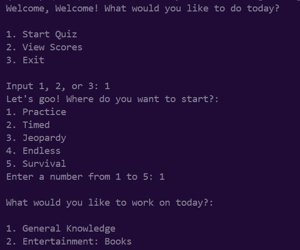

# QUIZME 

QuizMe is basically quizzes in different game modes :) Fun and educative! :)

There are two versions: Terminal and Streamlit UI

README:

[How to run](#how-to-run)

[Images](#images)

[yap](#yap)

--- 

## YAP

ngl I learned a lot from running this code countless times :) e.g. that this train station is in Wales :)

So, yes, QuizMe is fun and educative; Play QuizMe todayyy!!! :)) Also, for some more motivation: Beat my stats :)

# Images

## Streamlit UI

## Terminal :)

## How to run:

You can run this app in three ways:
- Streamlit website on app https://quizme-f98r.onrender.com/
- Terminal UI in your browser
- Streamlit UI in your browser.
  
### How to run either of the local options (last 2 options)

- Clone the repo
- Create a venv (optional)
- Run "pip install -r requirements.txt"
- Run:
  - "python main.py" for terminal OR
  - "streamlit run app.py" for streamlit

QuizMe has these main modes:
i plan to implement an exam mode in the future, every other one in my head are basically practice mode w a small twist! I might add as options later on!

- Practice Mode (just solve a random number of questions)
- Timed Mode (Solve questions in a limited amount of time)
- Jeopardy Mode, and (You're gambling on questions, more or less, this has to be my fav!! TRY IT! Try not to get below 0, then try to beat your last score.)
- Endless Mode (Keep solving until you're tired)

TECH STACK:
- Python
- Streamlit UI
- Open Trivia Database API and QuizAPI

Gonna come back and rebuild this as a web app with Flask/Django IN THE FUTURE TM!! (very soon actually!)